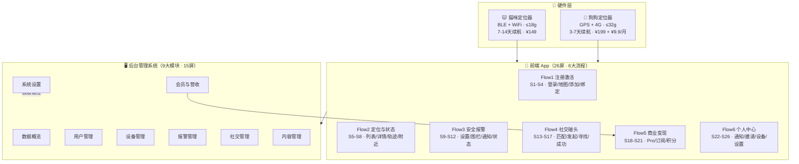

# 宠迹 PawTrack — 产品架构图

> 硬件定位器 + App 前端 + 后台管理系统 三位一体架构（Mermaid 版，替代 SVG）
> 渲染要求：GitHub / GitLab / VS Code（Markdown Preview Mermaid 插件）/ Typora 等支持 Mermaid 的 Markdown 查看器

## 猫狗差异化策略

| 维度 | 🐱 猫咪 | 🐶 狗狗 |
|------|---------|---------|
| 定位方式 | BLE + WiFi（室内） | GPS + 4G（户外） |
| 默认围栏 | 100m（楼栋范围）· 默认开启 | 300m（小区范围）· 默认关闭 |
| 报警优先级 | 离开围栏立即报警（高） | 开启后报警（中） |
| 社交倾向 | 不参与碰头匹配 | 参与碰头匹配 |
| 价格 | ¥149 | ¥199 + ¥9.9/月 |

---
*生成日期：2026-08-09 | 由 SVG 版转换，内容与 03_设计文档/宠迹_产品架构图.svg 一致*
