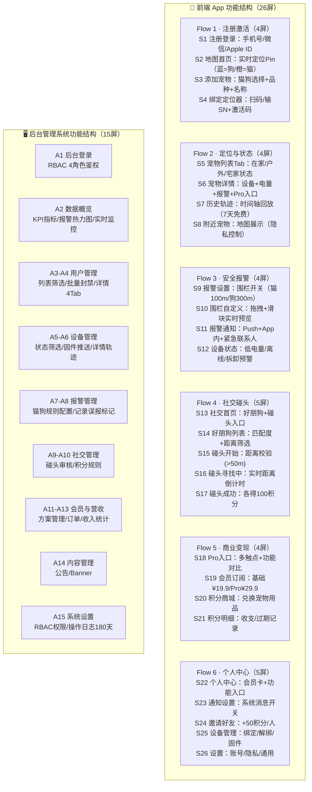

# 宠迹 PawTrack — 功能结构图

> 前端 26 屏 + 后台 15 屏 · 完整功能模块分解（Mermaid 版，替代 SVG）
> 渲染要求：支持 Mermaid 的 Markdown 查看器（GitHub / VS Code / Typora）

## 前端 26 屏总览（含优先级）

| 流程 | 屏幕 | 优先级 |
|------|------|:---:|
| Flow1 注册激活 | S1 登录 · S2 地图 · S3 添加宠物 · S4 绑定定位器 | P0 |
| Flow2 定位状态 | S5 宠物列表 · S6 宠物详情 · S7 历史轨迹 · S8 附近宠物 | P0+P1 |
| Flow3 安全报警 | S9 报警设置 · S10 围栏自定义 · S11 报警通知 · S12 设备状态 | P0 |
| Flow4 社交碰头 | S13 社交首页 · S14 好朋狗 · S15 碰头开始 · S16 寻找中 · S17 成功 | P2 |
| Flow5 商业变现 | S18 Pro入口 · S19 会员订阅 · S20 积分商城 · S21 积分明细 | P0+P1 |
| Flow6 个人中心 | S22 个人中心 · S23 通知设置 · S24 邀请好友 · S25 设备管理 · S26 设置 | P0+P1 |

---
*生成日期：2026-08-09 | 由 SVG 版转换，内容与 03_设计文档/宠迹_功能结构图.svg 一致*
