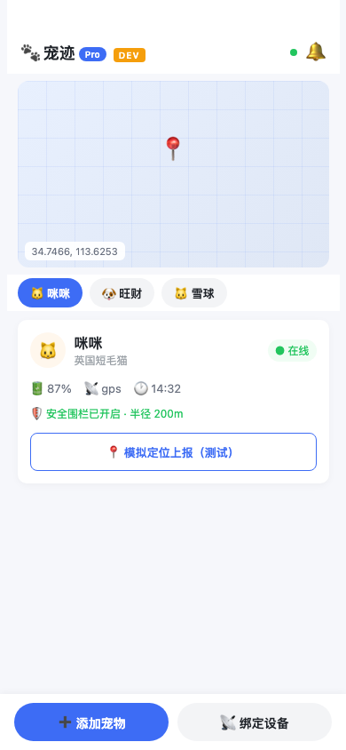
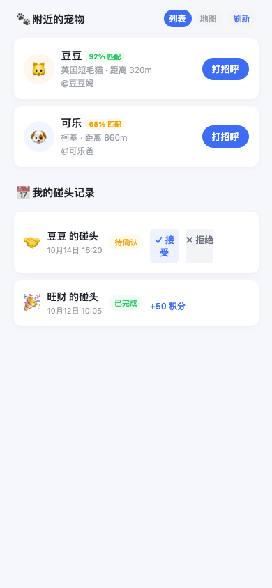

# 宠迹 PawTrack

> 宠物智能定位器配套 **SaaS**：把「定位 - 围栏 - 告警 - 社交 - 订阅」做成一套产品，并对猫狗做差异化策略设计。

## 这是什么

给宠物定位硬件配套的软件平台。核心策略是**猫狗分区**：

| 宠物 | 定位方案 | 侧重点 |
|---|---|---|
| 猫 | BLE + WiFi **室内看护** | 在宅范围、活动轨迹、离家提醒 |
| 狗 | GPS + 4G **户外定位与社交** | 实时位置、电子围栏、碰头社交 |

软件侧已实现核心模块：设备绑定与定位上报、围栏告警、宠物碰头状态机、三档会员权益。硬件侧完成了选型与协议方案设计。

## 技术栈

| 层 | 选型 |
|---|---|
| 后端 | FastAPI + PostgreSQL + Redis（定位缓存 / 实时态） |
| 管理后台 | React + Vite + TypeScript + Ant Design（默认 3001） |
| 小程序 | uni-app（Vue 3），可编译微信小程序 / H5 |
| 协议 | MQTT（设备上行）、BLE、OTA 升级方案（方案阶段） |
| 测试 | pytest（后端 32 passed / 8 skipped）、Vitest（后台） |

规模：**84 个接口**。

## 运行截图

> 以下为小程序页面结构示意，依本仓库 `04_前端项目/miniapp` 的真实前端代码渲染生成（非真机运行截图）。

| 宠迹首页（定位 / 宠物状态） | 附近宠物与碰头社交 |
|---|---|
|  |  |

## 本地启动

```bash
# 1) 后端（默认 8000）
cd 05_后端项目/backend
python -m venv .venv && source .venv/bin/activate
pip install -r requirements.txt
python -m uvicorn app.main:app --host 127.0.0.1 --port 8000 --reload

# 2) 管理后台（另开终端，默认 3001）
cd 04_前端项目/admin
npm install && npm run dev

# 3) 小程序（微信小程序 / H5）
cd 04_前端项目/miniapp
npm install && npm run dev:mp-weixin   # 微信小程序
# 或 npm run dev:h5                    # H5
```

```bash
# 后端测试
cd 05_后端项目/backend && pytest
```

## 诚实边界（重要）

- **硬件为方案阶段，未投产。** 已完成硬件选型、MQTT/BLE、OTA 协议方案设计，但无真实样机、未与厂商联调。简历里写的是「方案设计」，不是「已落地硬件」。
- **微信 / 支付 / 短信 / 地图未接入。** 真实登录、微信支付、短信、地图 Key、设备激活码均需上线前配置，当前为本地 Mock 验收。
- 「84 个接口 / 后端 32 passed」均来自本仓库，可现场复现。

## 项目状态

个人独立项目（2026.08 起）。软件侧 MVP 本地验收通过，进入生产配置与真实联调阶段；硬件待产线。

## 目录结构

```text
pawtrack/
├── 02-产品文档/    # BRD / MRD / PRD
├── 03-技术文档/    # API、数据库、硬件协议、围栏检测、MQ
├── 04-前端项目/
│   ├── admin/      # React + Vite 管理后台
│   └── miniapp/    # uni-app 小程序
├── 05-后端项目/backend/   # FastAPI
└── 05-UI设计/      # 原型 V2.1
```
